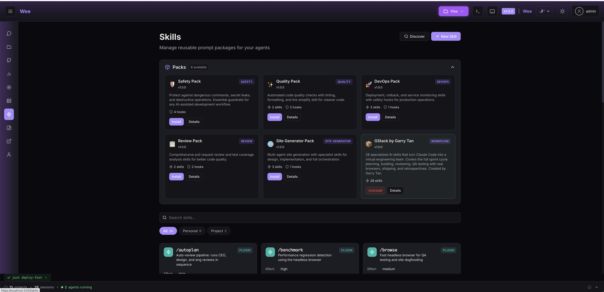
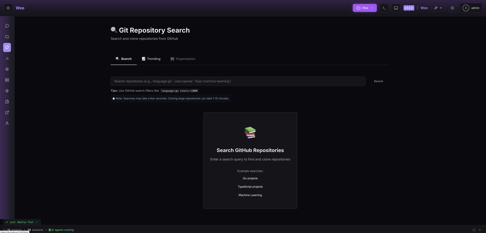
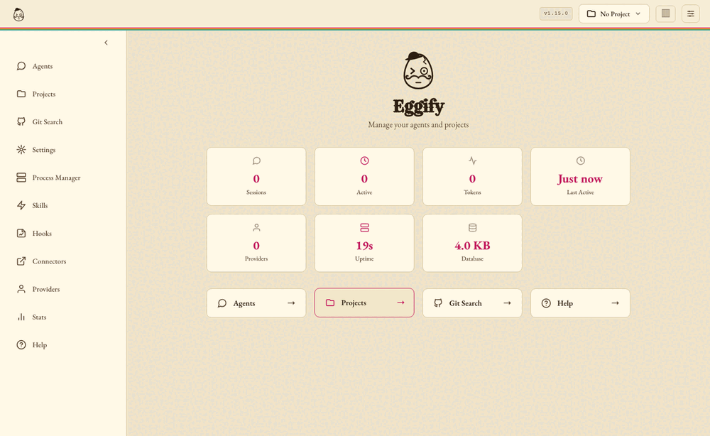
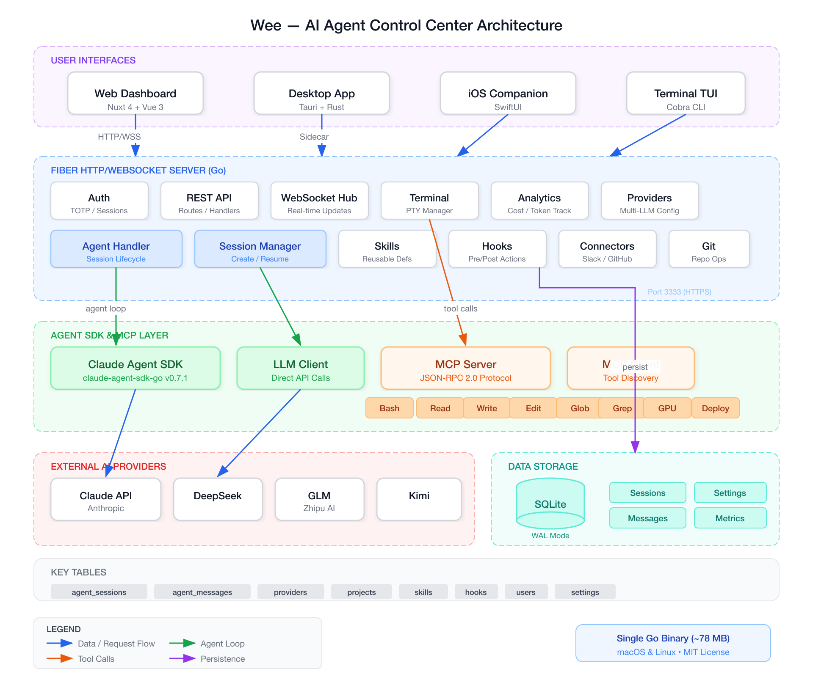

<p align="center">
  
</p>

<p align="center"><em>And now for something completely different: a control center for AI coding agents.</em></p>

<p align="center">
  <a href="https://go.dev/"></a>
  <a href="LICENSE"></a>
  <a href="https://github.com/schlunsen/eggify/actions/workflows/ci.yml"></a>
</p>


**The cockpit for engineers who run AI at scale.** Sandboxed agent sessions with full terminal access, real-time analytics, and multi-provider support.

https://github.com/user-attachments/assets/78529874-46e6-4720-96f4-00ac95bdfc88

<p align="center">
  <a href="docs/eggify-skills.png"></a>
  <a href="docs/eggify-git-search.png"></a>
</p>

<p align="center">
  <a href="https://schlunsen.github.io/eggify/">🌐 Website</a> &nbsp;|&nbsp;
  <a href="https://schlunsen.github.io/eggify/presentation.html">🎬 Presentation</a>
</p>

## What is Eggify?

Eggify is a self-hosted web dashboard that gives you a unified interface for working with AI coding agents. Think of it as the control plane for your agentic workflow:

- **Run multiple agent sessions** side-by-side with full tool support (Bash, Read, Write, Edit, and more)
- **Monitor everything in real-time** - token usage, costs, tool executions, git status, and session metrics
- **Voice-to-text input** using Parakeet v3 speech-to-text (runs locally, no API key needed)
- **Session handoff** - AI-powered context summarization to seamlessly continue work across sessions
- **Multi-provider support** - Claude, DeepSeek, GLM, Kimi, or any Anthropic-compatible API
- **Permission control** - granular tool permissions with YOLO mode for when you just want it done

Single binary. No dependencies. Runs on macOS and Linux.

## Quick Start

```bash
# Clone and build
git clone https://github.com/schlunsen/eggify
cd eggify
just build

# Launch (opens browser automatically)
./eggify
```

Create your admin user at the setup page, and you're in.

## Install

Eggify is free and open source (MIT). Download the Mac app from
[eggify.xyz](https://eggify.xyz) and open it; the app checks for updates itself.
Or build from source (Quick Start above). Each release includes notices for the
open-source components it contains.

## Key Features

### Agent Sessions
Run Claude agents directly in your browser. Each session gets its own working directory, git context, and permission settings. Create multiple sessions, switch between them, and monitor progress in real-time.

### Live Metrics Dashboard
Real-time WebSocket updates showing token usage, cost tracking, tool executions, git status, and active processes. Everything you need to understand what your agents are doing.

### Speech-to-Text
Built-in Parakeet v3 streaming speech recognition. Click the mic, speak your prompt, and send. No cloud API required - runs entirely in your browser.

### Multi-Provider
Configure and switch between AI providers without restarting. Supports Claude (default), DeepSeek, GLM, Kimi, and any custom Anthropic-compatible endpoint.

### Project Management
Auto-detects projects, tracks git branches, and organizes sessions by project. Sessions persist across restarts with full conversation history.

### Themes
Pick a theme in Settings → Appearance. Each comes in a light and a dark variant:
Eggify, **Flying Circus**, Default, Neon, Nord, Dracula and South Park.

**Flying Circus** matches the Eggify look: Victorian engravings cut out with
scissors and glued onto aged paper, with sepia ink, hand-tinted pink, mustard and
teal, circus-poster headings, and a typewriter font for code. Nobody expects it.

<p align="center">
  <a href="docs/eggify-flying-circus.png"></a>
</p>

See [the theme docs](internal/server/frontend/assets/css/themes/README.md) to add your own.

## Meet the egg

The Eggify mascot is a distinguished egg in a bowler hat. One eye is a `>`
prompt, the other a monocle with a blinking cursor for a pupil, and he wears a
handlebar moustache. The logo in the dashboard header is animated and shows
what your agents are doing:

| State | What the egg does |
|-------|-------------------|
| Idle | Blinks slowly behind the monocle |
| Working | Tips his hat |
| Streaming | Twitches his moustache and waggles his hat |
| Error | Hat squashed flat (a giant foot, presumably) |
| Sleeping | Hat slides down over his eyes |

## Architecture

Eggify is a single Go binary that serves:
- A **Nuxt 4 frontend** (embedded at build time)
- A **REST + WebSocket API** for real-time agent communication
- **SQLite storage** for sessions, messages, and settings
- **Claude Agent SDK** integration for native agent orchestration

<p align="center">
  <a href="docs/architecture.png"></a>
</p>

## Development

```bash
make build          # Build with frontend
make build-go       # Build Go binary only
make test           # Run tests
```

| Path | What lives there |
|------|------------------|
| `cmd/eggify/` | CLI entry point (`eggify` binary) |
| `internal/` | Go backend: server, agents, database, MCP (`eggify-tools`) |
| `internal/server/frontend/` | Nuxt 4 dashboard, embedded into the binary |
| `ios/eggify/` | SwiftUI iOS companion app |
| `src-tauri/` | Desktop app wrapper |

Eggify stores its data in `~/.claude/eggify/` (database `eggify.db`, API key
`.secret`, logs in `logs/`). Environment variables use the `EGGIFY_` prefix,
for example `EGGIFY_PORT` or `EGGIFY_AUTH_USER_AUTH_ENABLED`.

## License

Eggify is released under the [MIT License](LICENSE).
